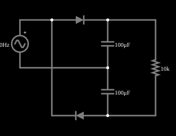

# Dobrador de tensão

<!-- navegacao:inicio -->
[Índice](README.md) · [Próximo: Voltage Doubler 2](voltdouble2.md)
<!-- navegacao:fim -->

## Objetivo

Mostrar um dobrador de tensão: dois diodos e dois capacitores transformam uma tensão alternada de $15\ \text{V}$ de pico em uma tensão contínua de cerca de $28\ \text{V}$.

## O circuito

<!-- esquema:inicio -->

<!-- esquema:fim -->

Uma fonte senoidal de $15\ \text{V}$ de pico e $40\ \text{Hz}$ alimenta dois diodos e dois capacitores de $100\ \mu\text{F}$ em série, ligados em ponte (cada diodo carrega um dos capacitores em um dos semiciclos); a carga é um resistor de $10\ \text{k}\Omega$ sobre os dois capacitores em série.

<!-- componentes:inicio -->
| N.º | Tipo | Elemento | Valores |
|----:|------|----------|---------|
| 0 | `VoltageElm` | A/C source | Max Voltage = 15; Waveform = A/C; DC Offset (V) = 0; Internal Resistance (ohms) = 0; Show Voltage = não; Frequency (Hz) = 40; Phase Offset (degrees) = 0 |
| 2 | `DiodeElm` | diode | Model = default |
| 3 | `CapacitorElm` | capacitor | Capacitance (F) = 100μ; Trapezoidal Approximation = sim; Initial Voltage (on Reset) = 1m; Series Resistance = 0 |
| 4 | `CapacitorElm` | capacitor | Capacitance (F) = 100μ; Trapezoidal Approximation = sim; Initial Voltage (on Reset) = 1m; Series Resistance = 0 |
| 7 | `DiodeElm` | diode | Model = default |
| 10 | `ResistorElm` | resistor | Resistance (ohms) = 10k |
<!-- componentes:fim -->

## Teoria

O diodo do simulador (modelo "default") segue a equação de Shockley,

$$i = I_s\left(e^{v/(nV_T)} - 1\right),\qquad I_s = 1{,}714\cdot 10^{-7}\ \text{A},\quad n = 2,\quad V_T = 25{,}865\ \text{mV},$$

sem resistência série. Para uma corrente $i \gg I_s$ a tensão é $v = nV_T\ln(i/I_s + 1)$, que dá $0{,}806\ \text{V}$ em $1\ \text{A}$, $0{,}568\ \text{V}$ em $10\ \text{mA}$ e $0{,}449\ \text{V}$ em $1\ \text{mA}$: a tensão cresce $nV_T\ln 10 = 119\ \text{mV}$ a cada década de corrente. Para $v < 0$ a corrente tende a $-I_s = -0{,}17\ \mu\text{A}$.

## Resultados esperados

A **ponte de Cockcroft–Walton** (multiplicador de tensão) usa diodos e capacitores para obter uma tensão contínua próxima de $N\,V_p$ a partir de uma fonte alternada de pico $V_p$, sem transformador. Cada capacitor é carregado até $V_p - V_D$ (um diodo é o "grampo" do exemplo anterior) e os capacitores se somam em série na saída. A cada ciclo, o capacitor de saída é recarregado e se descarrega na carga, de modo que há uma ondulação pequena na frequência da fonte (ou do dobro dela).

Neste dobrador, no semiciclo positivo um diodo carrega um capacitor até $V_p - V_D$ e no negativo o outro diodo carrega o segundo capacitor com a mesma tensão; as duas tensões se somam:

$$V_{saida} \approx 2\,(V_p - V_D),$$

com uma ondulação pico a pico de $\Delta V \approx I/(f\,C_{eq})$ em que $C_{eq} = 50\ \mu\text{F}$ é a associação em série. Cada diodo suporta uma tensão inversa de cerca de $2V_p$.

## O que observar

Em regime, a integração numérica independente (passo de $20\ \mu\text{s}$) dá:

| grandeza | valor |
|:---------|------:|
| tensão média na carga | $28{,}207\ \text{V}$ |
| máximo e mínimo (ondulação) | $28{,}502$ e $27{,}892\ \text{V}$ ($0{,}61\ \text{V}$ p–p) |
| tensão média de cada capacitor | $14{,}104\ \text{V}$ |
| tensão inversa máxima de um diodo | $29{,}09\ \text{V}$ |

Cada capacitor se carrega até o pico menos a queda do diodo na corrente de carga (pico de $90\ \text{mA}$, queda de $0{,}68\ \text{V}$): $15 - 0{,}68 = 14{,}32\ \text{V}$; a carga o descarrega um pouco entre os picos, e a tensão média de cada um é $14{,}10\ \text{V}$. A saída fica em $28{,}2\ \text{V}$, contra $30\ \text{V}$ ideais. A tensão chega ao regime em menos de $1\ \text{s}$. As verificações conferem a média, o máximo e o mínimo da carga, a média de um capacitor e a tensão inversa de um diodo, de $0{,}9$ a $1\ \text{s}$ (tolerância de 1%; o simulador fica a menos de $0{,}003\%$ do cálculo independente).

## Limites do modelo

- A carga recebe cerca de $28\ \text{V}$ de uma fonte de $15\ \text{V}$ de pico.
- A ondulação sobe com a corrente da carga e desce com a capacitância e a frequência.
- Compare com o triplicador e o quadruplicador: mais estágios, mais tensão, e queda de tensão por estágio maior sob carga.

## Referências

Fonte ideal (resistência nula) e diodos sem resistência série; numa fonte real, a resistência limita a corrente de carga dos capacitores e reduz a tensão de saída. Os multiplicadores reais têm uma queda de tensão sob carga que cresce depressa com o número de estágios.

O circuito deste exemplo faz parte da coleção do simulador original de Paul Falstad e Iain Sharp (CircuitJS1); a explicação é deste projeto.
