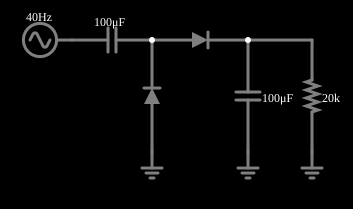

# Dobrador de tensão 2

<!-- navegacao:inicio -->
[Índice](README.md) · [Anterior: Voltage Doubler](voltdouble.md) · [Próximo: Voltage Tripler](volttriple.md)
<!-- navegacao:fim -->

## Objetivo

Mostrar a outra forma clássica de dobrador de tensão (a de Greinacher/Villard): um capacitor de acoplamento grampeia a fonte e um segundo diodo com capacitor de saída retifica o sinal deslocado.

## O circuito

<!-- esquema:inicio -->

<!-- esquema:fim -->

Uma fonte de $15\ \text{V}$ de pico e $40\ \text{Hz}$ alimenta um capacitor de $100\ \mu\text{F}$ em série (acoplamento). O lado de saída do capacitor tem um diodo para a terra (grampo) e um segundo diodo que alimenta, em série, um capacitor de saída de $100\ \mu\text{F}$ e a carga de $20\ \text{k}\Omega$.

<!-- componentes:inicio -->
| N.º | Tipo | Elemento | Valores |
|----:|------|----------|---------|
| 0 | `RailElm` | A/C source | Max Voltage = 15; Waveform = A/C; DC Offset (V) = 0; Internal Resistance (ohms) = 0; Show Voltage = não; Frequency (Hz) = 40; Phase Offset (degrees) = 0 |
| 1 | `CapacitorElm` | capacitor | Capacitance (F) = 100μ; Trapezoidal Approximation = sim; Initial Voltage (on Reset) = 1m; Series Resistance = 0 |
| 2 | `DiodeElm` | diode | Model = default |
| 3 | `DiodeElm` | diode | Model = default |
| 4 | `CapacitorElm` | capacitor | Capacitance (F) = 100μ; Trapezoidal Approximation = sim; Initial Voltage (on Reset) = 1m; Series Resistance = 0 |
| 5 | `GroundElm` | ground | Symbol = Earth |
| 6 | `GroundElm` | ground | Symbol = Earth |
| 8 | `ResistorElm` | resistor | Resistance (ohms) = 20k |
| 9 | `GroundElm` | ground | Symbol = Earth |
<!-- componentes:fim -->

## Teoria

O diodo do simulador (modelo "default") segue a equação de Shockley,

$$i = I_s\left(e^{v/(nV_T)} - 1\right),\qquad I_s = 1{,}714\cdot 10^{-7}\ \text{A},\quad n = 2,\quad V_T = 25{,}865\ \text{mV},$$

sem resistência série. Para uma corrente $i \gg I_s$ a tensão é $v = nV_T\ln(i/I_s + 1)$, que dá $0{,}806\ \text{V}$ em $1\ \text{A}$, $0{,}568\ \text{V}$ em $10\ \text{mA}$ e $0{,}449\ \text{V}$ em $1\ \text{mA}$: a tensão cresce $nV_T\ln 10 = 119\ \text{mV}$ a cada década de corrente. Para $v < 0$ a corrente tende a $-I_s = -0{,}17\ \mu\text{A}$.

## Resultados esperados

A **ponte de Cockcroft–Walton** (multiplicador de tensão) usa diodos e capacitores para obter uma tensão contínua próxima de $N\,V_p$ a partir de uma fonte alternada de pico $V_p$, sem transformador. Cada capacitor é carregado até $V_p - V_D$ (um diodo é o "grampo" do exemplo anterior) e os capacitores se somam em série na saída. A cada ciclo, o capacitor de saída é recarregado e se descarrega na carga, de modo que há uma ondulação pequena na frequência da fonte (ou do dobro dela).

O primeiro estágio é o grampo (restauração de CC): o capacitor de acoplamento fica com $V_p - V_D$ e desloca o sinal para $[-V_D,\ 2V_p - V_D]$. O segundo estágio é um retificador de pico: o capacitor de saída se carrega ao máximo do sinal grampeado,

$$V_{saida} \approx 2V_p - 2V_D.$$

## O que observar

Em regime, a integração numérica independente dá:

| grandeza | valor |
|:---------|------:|
| tensão média na carga | $28{,}390\ \text{V}$ |
| máximo e mínimo (ondulação) | $28{,}552$ e $28{,}222\ \text{V}$ ($0{,}33\ \text{V}$ p–p) |
| tensão média do capacitor de acoplamento | $14{,}258\ \text{V}$ |

Com a carga de $20\ \text{k}\Omega$ (a metade da corrente do dobrador anterior) e o capacitor de saída tendo toda a capacitância de $100\ \mu\text{F}$, a ondulação é menor ($0{,}33\ \text{V}$ contra $0{,}61\ \text{V}$) e a saída é um pouco maior ($28{,}39\ \text{V}$). As verificações conferem a média, o máximo e o mínimo da carga e a média do capacitor de acoplamento, de $0{,}9$ a $1\ \text{s}$ (tolerância de 1%; o simulador fica a menos de $0{,}003\%$ do cálculo independente).

## Limites do modelo

- Compare as duas formas do dobrador: ambas dão cerca de $28\ \text{V}$; a primeira tem a carga flutuante sobre dois capacitores em série; esta tem a saída referida à terra.
- O capacitor de acoplamento sofre a tensão de um dos lados do sinal; o de saída, a de $2V_p$.
- A ondulação cai ao dobrar a capacitância de saída.

## Referências

Fonte ideal, diodos sem resistência série e capacitores sem resistência série equivalente.

O circuito deste exemplo faz parte da coleção do simulador original de Paul Falstad e Iain Sharp (CircuitJS1); a explicação é deste projeto.
