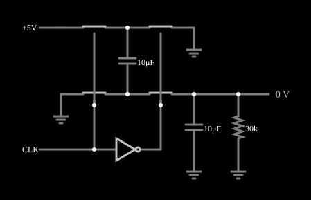

# Inversor de tensão por capacitor chaveado

<!-- navegacao:inicio -->
[Índice](README.md) · [Anterior: Switchable Filter](switchfilter.md) · [Próximo: Inverter Amplifier](invertamp.md)
<!-- navegacao:fim -->

## Objetivo

Mostrar um **inversor de tensão com capacitor chaveado** (bomba de carga): a partir de uma alimentação de $+5\ \text{V}$ ele produz uma tensão **negativa** de cerca de $-5\ \text{V}$ sem indutores, só com quatro chaves e dois capacitores.

## O circuito

<!-- esquema:inicio -->

<!-- esquema:fim -->

Quatro chaves analógicas (resistência de ligado de $20\ \Omega$, de desligado de $10\ \text{G}\Omega$, limiar de controle de $2{,}5\ \text{V}$) e dois capacitores de $10\ \mu\text{F}$ formam o conversor: um capacitor "voador" $C_1$ e um capacitor de saída $C_2$ (reservatório), com uma carga de $30\ \text{k}\Omega$ à terra. As chaves são comandadas por um gerador de onda quadrada de $400\ \text{Hz}$ ($0$ a $5\ \text{V}$) e pelo seu complemento, através de um inversor.

<!-- componentes:inicio -->
| N.º | Tipo | Elemento | Valores |
|----:|------|----------|---------|
| 0 | `AnalogSwitchElm` | analog switch | Normally closed = não; On Resistance (ohms) = 20; Off Resistance (ohms) = 10G; Pulldown Resistor = não; Threshold = 2.5 |
| 1 | `AnalogSwitchElm` | analog switch | Normally closed = não; On Resistance (ohms) = 20; Off Resistance (ohms) = 10G; Pulldown Resistor = não; Threshold = 2.5 |
| 2 | `CapacitorElm` | capacitor | Capacitance (F) = 10μ; Trapezoidal Approximation = sim; Initial Voltage (on Reset) = 1m; Series Resistance = 0 |
| 3 | `AnalogSwitchElm` | analog switch | Normally closed = não; On Resistance (ohms) = 20; Off Resistance (ohms) = 10G; Pulldown Resistor = não; Threshold = 2.5 |
| 4 | `AnalogSwitchElm` | analog switch | Normally closed = não; On Resistance (ohms) = 20; Off Resistance (ohms) = 10G; Pulldown Resistor = não; Threshold = 2.5 |
| 5 | `GroundElm` | ground | Symbol = Earth |
| 6 | `CapacitorElm` | capacitor | Capacitance (F) = 10μ; Trapezoidal Approximation = sim; Initial Voltage (on Reset) = 1m; Series Resistance = 0 |
| 7 | `GroundElm` | ground | Symbol = Earth |
| 8 | `GroundElm` | ground | Symbol = Earth |
| 9 | `RailElm` | voltage source | Voltage = 5; Waveform = D/C; DC Offset (V) = 0; Internal Resistance (ohms) = 0 |
| 14 | `InverterElm` | inverter | Slew Rate (V/ns) = 500m; High Logic Voltage = 5; DeMorgan's Symbol = não |
| 15 | `RailElm` | square wave gen | Max Voltage = 2.5; Waveform = Square Wave; DC Offset (V) = 2.5; Internal Resistance (ohms) = 0; Show Voltage = não; Specify As = Frequency/Duty Cycle; Frequency (Hz) = 400; Phase Offset (degrees) = 0; Duty Cycle = 50; Rise/Fall Time (s) = 0 |
| 17 | `ResistorElm` | resistor | Resistance (ohms) = 30k |
| 18 | `GroundElm` | ground | Symbol = Earth |
| 19 | `OutputElm` | output | Show Voltage = sim; Scale = Auto |
<!-- componentes:fim -->

## Teoria

O conversor tem duas fases por ciclo:

1. **Carga:** $C_1$ é ligado entre $+V_{in}$ e a terra e se carrega a $V_{in}$ (as duas chaves de entrada).
2. **Transferência:** as chaves se invertem e $C_1$ é ligado com a polaridade trocada entre a terra e o reservatório: a placa positiva vai à terra e a negativa ao nó de saída, de modo que $C_1$ transfere a sua carga ao reservatório, que fica em $V_{out} \approx -V_{in}$.

Sem carga, $V_{out} = -V_{in}$; com corrente de saída $I$, aparece uma queda $V_{in} - |V_{out}| = I\,R_{out}$, onde, para um conversor de duas fases com capacitores iguais, no limite de chaveamento lento $R_{out} \approx 1/(f\,C_1) = 250\ \Omega$, mais os termos das resistências de ligado das chaves. A ondulação da saída é de $\Delta V \approx I/(f\,C_2)$.

## Resultados esperados

Em regime (a saída se estabiliza em cerca de $50\ \text{ms}$: a média em janelas consecutivas de $12{,}5\ \text{ms}$ (cinco ciclos do relógio) passa de $-3{,}30\ \text{V}$ na primeira a $-4{,}79\ \text{V}$ na segunda e a $-4{,}85\ \text{V}$ na quarta), o simulador dá $V_{out} = -4{,}8497\ \text{V}$ em média, com ondulação de $-4{,}8922$ a $-4{,}8088\ \text{V}$ ($83\ \text{mV}$ pico a pico) e uma corrente na carga de $0{,}1617\ \text{mA}$ ($4{,}85/30\ \text{k}\Omega$). A saída é $97\%$ de $-V_{in}$, uma queda de $0{,}150\ \text{V}$, que corresponde a $R_{out} = 0{,}150/0{,}1617\ \text{mA} = 0{,}93\ \text{k}\Omega$, bem acima de $1/(fC_1) = 250\ \Omega$. A ondulação prevista, $I/(fC_2) = 0{,}1617\ \text{mA}/(400 \cdot 10\ \mu\text{F}) = 40\ \text{mV}$, é a metade da medida ($83\ \text{mV}$). A alimentação fornece em média $0{,}6546\ \text{mA}$, quatro vezes a corrente da carga, de modo que o rendimento ($4{,}85 \cdot 0{,}1617/(5 \cdot 0{,}6546) = 24\%$) é muito menor que o ideal ($\approx 97\%$); o pico de corrente da alimentação é de $0{,}126\ \text{A}$, que é $5\ \text{V}/(2 \cdot 20\ \Omega) = 0{,}125\ \text{A}$, o valor de dois resistores de ligado em série ligados à alimentação. As verificações conferem a média, o mínimo e o máximo da saída, as correntes média da carga e da alimentação, e a frequência do relógio (tolerância de $0{,}2\%$ a $1\%$).

## O que observar

A saída vai de $0$ a $-4{,}85\ \text{V}$ em poucos ciclos do relógio e fica com uma pequena ondulação na frequência de $400\ \text{Hz}$. Para testar: troque a carga de $30\ \text{k}\Omega$ por $3\ \text{k}\Omega$ e veja a queda aumentar (proporcional à corrente) e a ondulação crescer; aumente os capacitores para $100\ \mu\text{F}$ e veja a ondulação e a resistência de saída cair.

## Limites do modelo

- O excesso de corrente da alimentação (rendimento de $24\%$) tem uma explicação consistente com os números, mas não verificada diretamente: a cada borda do relógio, o inversor que gera o sinal complementar atrasa-se um passo de tempo ($5\ \mu\text{s}$), de modo que duas chaves em série entre a alimentação e a terra ficam ligadas ao mesmo tempo por esse passo e deixam passar $5\ \text{V}/40\ \Omega = 0{,}125\ \text{A}$: $0{,}125\ \text{A} \cdot 5\ \mu\text{s} \cdot 2$ bordas por ciclo $\cdot 400\ \text{Hz} = 0{,}5\ \text{mA}$, quase exatamente os $0{,}49\ \text{mA}$ a mais. Um conversor real usa um relógio de duas fases sem sobreposição.
- A resistência de saída medida, $0{,}93\ \text{k}\Omega$, é maior que a prevista para chaves ideais; a diferença não foi analisada aqui.
- As chaves são ideais (resistência constante, sem capacitâncias nem injeção de carga) e o relógio é perfeito.
- Os valores de rendimento e a estimativa do excesso são medidas e contas feitas a partir do simulador, e não fazem parte das verificações automáticas.

## Referências

Sedra e Smith, *Microelectronic Circuits*, seção sobre circuitos de capacitor chaveado; Seeman e Sanders, "Analysis and optimization of switched-capacitor DC–DC converters", *IEEE Trans. Power Electronics*, 2008.

O circuito deste exemplo faz parte da coleção do simulador original de Paul Falstad e Iain Sharp (CircuitJS1); a explicação é deste projeto.
