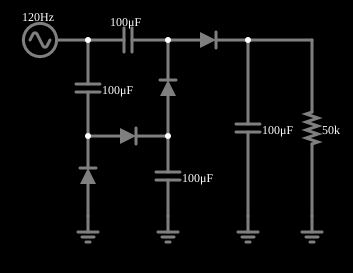

# Quadruplicador de tensão

<!-- navegacao:inicio -->
[Índice](README.md) · [Anterior: Voltage Tripler](volttriple.md)
<!-- navegacao:fim -->

## Objetivo

Mostrar um quadruplicador de tensão: quatro diodos e quatro capacitores obtêm cerca de $57\ \text{V}$ de uma fonte de $15\ \text{V}$ de pico.

## O circuito

<!-- esquema:inicio -->

<!-- esquema:fim -->

Uma fonte de $15\ \text{V}$ de pico e $120\ \text{Hz}$ alimenta uma cadeia de quatro diodos e quatro capacitores de $100\ \mu\text{F}$, com uma carga de $50\ \text{k}\Omega$.

<!-- componentes:inicio -->
| N.º | Tipo | Elemento | Valores |
|----:|------|----------|---------|
| 0 | `DiodeElm` | diode | Model = default |
| 1 | `CapacitorElm` | capacitor | Capacitance (F) = 100μ; Trapezoidal Approximation = sim; Initial Voltage (on Reset) = 1m; Series Resistance = 0 |
| 2 | `DiodeElm` | diode | Model = default |
| 3 | `CapacitorElm` | capacitor | Capacitance (F) = 100μ; Trapezoidal Approximation = sim; Initial Voltage (on Reset) = 1m; Series Resistance = 0 |
| 5 | `ResistorElm` | resistor | Resistance (ohms) = 50k |
| 6 | `GroundElm` | ground | Symbol = Earth |
| 7 | `GroundElm` | ground | Symbol = Earth |
| 8 | `GroundElm` | ground | Symbol = Earth |
| 9 | `RailElm` | A/C source | Max Voltage = 15; Waveform = A/C; DC Offset (V) = 0; Internal Resistance (ohms) = 0; Show Voltage = não; Frequency (Hz) = 120; Phase Offset (degrees) = 0 |
| 10 | `DiodeElm` | diode | Model = default |
| 11 | `DiodeElm` | diode | Model = default |
| 12 | `CapacitorElm` | capacitor | Capacitance (F) = 100μ; Trapezoidal Approximation = sim; Initial Voltage (on Reset) = 1m; Series Resistance = 0 |
| 13 | `GroundElm` | ground | Symbol = Earth |
| 14 | `CapacitorElm` | capacitor | Capacitance (F) = 100μ; Trapezoidal Approximation = sim; Initial Voltage (on Reset) = 1m; Series Resistance = 0 |
<!-- componentes:fim -->

## Teoria

O diodo do simulador (modelo "default") segue a equação de Shockley,

$$i = I_s\left(e^{v/(nV_T)} - 1\right),\qquad I_s = 1{,}714\cdot 10^{-7}\ \text{A},\quad n = 2,\quad V_T = 25{,}865\ \text{mV},$$

sem resistência série. Para uma corrente $i \gg I_s$ a tensão é $v = nV_T\ln(i/I_s + 1)$, que dá $0{,}806\ \text{V}$ em $1\ \text{A}$, $0{,}568\ \text{V}$ em $10\ \text{mA}$ e $0{,}449\ \text{V}$ em $1\ \text{mA}$: a tensão cresce $nV_T\ln 10 = 119\ \text{mV}$ a cada década de corrente. Para $v < 0$ a corrente tende a $-I_s = -0{,}17\ \mu\text{A}$.

## Resultados esperados

A **ponte de Cockcroft–Walton** (multiplicador de tensão) usa diodos e capacitores para obter uma tensão contínua próxima de $N\,V_p$ a partir de uma fonte alternada de pico $V_p$, sem transformador. Cada capacitor é carregado até $V_p - V_D$ (um diodo é o "grampo" do exemplo anterior) e os capacitores se somam em série na saída. A cada ciclo, o capacitor de saída é recarregado e se descarrega na carga, de modo que há uma ondulação pequena na frequência da fonte (ou do dobro dela).

Com $N = 4$ estágios, $V_{saida} \approx 4\,(V_p - V_D)$.

## O que observar

Em regime, a integração numérica independente dá:

| grandeza | valor |
|:---------|------:|
| tensão média na carga | $57{,}315\ \text{V}$ |
| ondulação (máximo e mínimo) | $57{,}360$ e $57{,}270\ \text{V}$ ($0{,}09\ \text{V}$ p–p) |
| tensão média dos capacitores | $14{,}343$, $28{,}667$, $42{,}990$ e $57{,}315\ \text{V}$ (em módulo) |

A saída é $57{,}3\ \text{V}$ contra $60\ \text{V}$ ideais. As verificações conferem a média, o máximo e o mínimo da carga e a tensão média do capacitor do primeiro estágio, de $0{,}9$ a $1\ \text{s}$ (tolerância de 1%; o simulador fica a menos de $0{,}002\%$ do cálculo independente).

## Limites do modelo

- A tensão de saída é quatro vezes a de um estágio: $4\cdot 14{,}33 = 57{,}3\ \text{V}$.
- Compare com o dobrador e o triplicador: a tensão por estágio é praticamente a mesma ($\approx 14{,}3\ \text{V}$).
- Cada capacitor só suporta a tensão de seu estágio, uma vantagem em alta tensão.

## Referências

As mesmas limitações do triplicador: fonte ideal, queda de tensão sob carga que cresce depressa com o número de estágios, e corrente da carga muito pequena.

O circuito deste exemplo faz parte da coleção do simulador original de Paul Falstad e Iain Sharp (CircuitJS1); a explicação é deste projeto.
