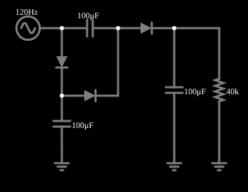

# Triplicador de tensão

<!-- navegacao:inicio -->
[Índice](README.md) · [Anterior: Voltage Doubler 2](voltdouble2.md) · [Próximo: Voltage Quadrupler](voltquad.md)
<!-- navegacao:fim -->

## Objetivo

Mostrar um triplicador de tensão: três diodos e três capacitores obtêm cerca de $43\ \text{V}$ de uma fonte de $15\ \text{V}$ de pico.

## O circuito

<!-- esquema:inicio -->

<!-- esquema:fim -->

Uma fonte de $15\ \text{V}$ de pico e $120\ \text{Hz}$ alimenta uma cadeia de três diodos e três capacitores de $100\ \mu\text{F}$ (cada capacitor é carregado por um diodo em um dos semiciclos), com uma carga de $40\ \text{k}\Omega$.

<!-- componentes:inicio -->
| N.º | Tipo | Elemento | Valores |
|----:|------|----------|---------|
| 0 | `DiodeElm` | diode | Model = default |
| 1 | `DiodeElm` | diode | Model = default |
| 3 | `CapacitorElm` | capacitor | Capacitance (F) = 100μ; Trapezoidal Approximation = sim; Initial Voltage (on Reset) = 1m; Series Resistance = 0 |
| 4 | `CapacitorElm` | capacitor | Capacitance (F) = 100μ; Trapezoidal Approximation = sim; Initial Voltage (on Reset) = 1m; Series Resistance = 0 |
| 5 | `DiodeElm` | diode | Model = default |
| 6 | `CapacitorElm` | capacitor | Capacitance (F) = 100μ; Trapezoidal Approximation = sim; Initial Voltage (on Reset) = 1m; Series Resistance = 0 |
| 8 | `ResistorElm` | resistor | Resistance (ohms) = 40k |
| 9 | `GroundElm` | ground | Symbol = Earth |
| 10 | `GroundElm` | ground | Symbol = Earth |
| 11 | `GroundElm` | ground | Symbol = Earth |
| 12 | `RailElm` | A/C source | Max Voltage = 15; Waveform = A/C; DC Offset (V) = 0; Internal Resistance (ohms) = 0; Show Voltage = não; Frequency (Hz) = 120; Phase Offset (degrees) = 0 |
<!-- componentes:fim -->

## Teoria

O diodo do simulador (modelo "default") segue a equação de Shockley,

$$i = I_s\left(e^{v/(nV_T)} - 1\right),\qquad I_s = 1{,}714\cdot 10^{-7}\ \text{A},\quad n = 2,\quad V_T = 25{,}865\ \text{mV},$$

sem resistência série. Para uma corrente $i \gg I_s$ a tensão é $v = nV_T\ln(i/I_s + 1)$, que dá $0{,}806\ \text{V}$ em $1\ \text{A}$, $0{,}568\ \text{V}$ em $10\ \text{mA}$ e $0{,}449\ \text{V}$ em $1\ \text{mA}$: a tensão cresce $nV_T\ln 10 = 119\ \text{mV}$ a cada década de corrente. Para $v < 0$ a corrente tende a $-I_s = -0{,}17\ \mu\text{A}$.

## Resultados esperados

A **ponte de Cockcroft–Walton** (multiplicador de tensão) usa diodos e capacitores para obter uma tensão contínua próxima de $N\,V_p$ a partir de uma fonte alternada de pico $V_p$, sem transformador. Cada capacitor é carregado até $V_p - V_D$ (um diodo é o "grampo" do exemplo anterior) e os capacitores se somam em série na saída. A cada ciclo, o capacitor de saída é recarregado e se descarrega na carga, de modo que há uma ondulação pequena na frequência da fonte (ou do dobro dela).

Com $N = 3$ estágios a tensão de saída é aproximadamente $3\,(V_p - V_D)$, e cada capacitor sucessivo se carrega a um múltiplo de $V_p - V_D$ ($1$, $2$ e $3$ vezes).

## O que observar

Em regime, a integração numérica independente dá:

| grandeza | valor |
|:---------|------:|
| tensão média na carga | $43{,}008\ \text{V}$ |
| ondulação (máximo e mínimo) | $43{,}050$ e $42{,}965\ \text{V}$ ($0{,}08\ \text{V}$ p–p) |
| tensão média dos capacitores | $14{,}347$, $28{,}677$ e $43{,}008\ \text{V}$ |

A saída é $43{,}0\ \text{V}$ contra $45\ \text{V}$ ideais ($0{,}66\ \text{V}$ por estágio a menos que o pico: cada capacitor se carrega a um múltiplo de $14{,}35\ \text{V}$, e não de $15\ \text{V}$). As verificações conferem a média, o máximo e o mínimo da carga e a tensão média do primeiro capacitor, de $0{,}9$ a $1\ \text{s}$ (tolerância de 1%; o simulador fica a menos de $0{,}002\%$ do cálculo independente).

## Limites do modelo

- Cada capacitor da cadeia tem uma tensão contínua maior que o anterior, em múltiplos de $\approx 14{,}3\ \text{V}$.
- A carga é bem leve ($40\ \text{k}\Omega$, $1\ \text{mA}$), por isso a ondulação é pequena e a queda de tensão por estágio também.
- Aumente a carga (menor $R$): a tensão de saída cai e a ondulação sobe.

## Referências

Fonte ideal e diodos ideais no sentido do modelo (sem resistência série). Num multiplicador de Cockcroft–Walton real a queda de tensão sob carga cresce aproximadamente com o cubo do número de estágios ($\Delta V \approx \tfrac{I}{fC}\cdot\tfrac{2N^3}{3}$ para $N$ grande), e é por isso que ele é usado com correntes muito pequenas.

O circuito deste exemplo faz parte da coleção do simulador original de Paul Falstad e Iain Sharp (CircuitJS1); a explicação é deste projeto.
