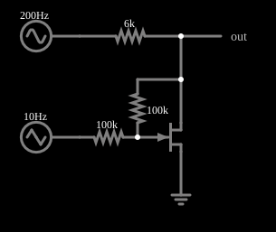

# Controle de volume com JFET

<!-- navegacao:inicio -->
[Índice](README.md) · [Anterior: Common-Source Amplifier](jfetamp.md) · [Próximo: Lambda Diode](lambda-diode.md)
<!-- navegacao:fim -->

## Objetivo

Mostrar o JFET como um **resistor controlado por tensão**: a tensão no gatilho muda a resistência do canal, e com ela a amplitude de um sinal de áudio, como um controle de volume.

## O circuito

<!-- esquema:inicio -->

<!-- esquema:fim -->

Uma fonte senoidal de $5\ \text{V}$ de pico e $200\ \text{Hz}$ (o sinal) passa por um resistor de $6\ \text{k}\Omega$ para o nó de saída, que está ligado ao dreno do JFET (a fonte vai à terra); o canal do JFET forma, com o resistor, um divisor de tensão. O gatilho recebe, por dois resistores de $100\ \text{k}\Omega$, a média entre o nó de saída e uma tensão de controle: uma onda triangular de $10\ \text{Hz}$ entre $-11\ \text{V}$ e $-5\ \text{V}$ (a *volume*). Os dois osciloscópios mostram o controle e a saída.

<!-- componentes:inicio -->
| N.º | Tipo | Elemento | Valores |
|----:|------|----------|---------|
| 0 | `NJfetElm` | JFET | Model = default-jfet; Swap D/S = não |
| 1 | `ResistorElm` | resistor | Resistance (ohms) = 100k |
| 2 | `ResistorElm` | resistor | Resistance (ohms) = 100k |
| 5 | `GroundElm` | ground | Symbol = Earth |
| 7 | `ResistorElm` | resistor | Resistance (ohms) = 6k |
| 8 | `OutputElm` | output | Show Voltage = não |
| 9 | `RailElm` | A/C source | Max Voltage = 5; Waveform = A/C; DC Offset (V) = 0; Internal Resistance (ohms) = 0; Show Voltage = não; Frequency (Hz) = 200; Phase Offset (degrees) = 0 |
| 10 | `RailElm` | triangle gen | Max Voltage = 3; Waveform = Triangle; DC Offset (V) = -8; Internal Resistance (ohms) = 0; Show Voltage = não; Frequency (Hz) = 10; Phase Offset (degrees) = 0 |
<!-- componentes:fim -->

## Teoria

Com $V_{DS}$ pequeno, o JFET se comporta como um resistor cuja condutância é controlada por $V_{GS}$:

$$G_{ds} = \left.\frac{\partial I_D}{\partial V_{DS}}\right|_{V_{DS}\to 0} = \beta\thinspace(V_{GS} - V_T) = 1{,}25\ \text{mS}\cdot(V_{GS} + 4\ \text{V}).$$

Para $V_{GS} \le V_T = -4\ \text{V}$ o canal está cortado e o divisor não atenua. À medida que $V_{GS}$ sobe, a resistência do canal cai e a saída $v_o = v_s\thinspace R_{ds}/(R_{ds} + 6\ \text{k}\Omega)$ diminui. A realimentação do nó de saída para o gatilho (o segundo resistor de $100\ \text{k}\Omega$) faz $V_{GS}$ acompanhar metade do sinal e lineariza a resistência do canal, reduzindo a distorção.

## Resultados esperados

O simulador dá, para a amplitude de pico da saída em cada trecho do período de $0{,}1\ \text{s}$ da triangular de controle:

| Controle (extremos) | Amplitude da saída |
|---|---:|
| $-11\ \text{V}$ a $-9{,}5\ \text{V}$ (início do ciclo) | $3{,}76\ \text{V}$ |
| $-8\ \text{V}$ a $-6{,}5\ \text{V}$ | $1{,}65\ \text{V}$ |
| $-6{,}5\ \text{V}$ a $-5\ \text{V}$ (volume mínimo) | $0{,}66\ \text{V}$ |
| $-9{,}5\ \text{V}$ a $-8\ \text{V}$ (volta) | $2{,}75\ \text{V}$ |

Quanto mais perto de $-5\ \text{V}$ fica o controle, menor é a saída: o volume vai de $3{,}8\ \text{V}$ a $0{,}66\ \text{V}$ ao longo de $50\ \text{ms}$ e volta.

## O que observar

O osciloscópio de saída mostra a senoide de $200\ \text{Hz}$ com a amplitude pulsando no ritmo de $10\ \text{Hz}$ do controle: um efeito de tremolo. Substitua a triangular por uma tensão contínua e a amplitude fica constante, no nível que a tensão determina.

## Limites do modelo

- Com $V_{GS}$ perto do corte e sinal grande, o canal sai da região linear e a saída sofre distorção; o resultado é mais um controle de ganho que um atenuador de alta fidelidade.
- O modelo não tem capacitâncias: não há perda de agudos nem acoplamento do controle ao sinal (*feedthrough*), efeitos reais em controles de volume com JFET.

## Referências

Sedra e Smith, *Microeletrônica*, capítulo sobre transistores de efeito de campo (JFET); Horowitz e Hill, *The Art of Electronics*, capítulo sobre transistores de efeito de campo.

O circuito deste exemplo faz parte da coleção do simulador original de Paul Falstad e Iain Sharp (CircuitJS1); a explicação é deste projeto.
