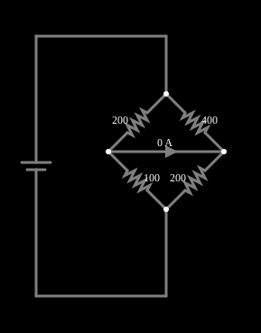

# Ponte de Wheatstone

<!-- navegacao:inicio -->
[Índice](README.md) · [Anterior: Differentiator](diff.md) · [Próximo: Critically Damped LRC](lrc-critical.md)
<!-- navegacao:fim -->

## Objetivo

Mostrar a ponte de Wheatstone: um circuito de quatro resistores e um medidor que permite comparar resistências com grande precisão, ao achar a condição em que o medidor indica zero.

## O circuito

<!-- esquema:inicio -->

<!-- esquema:fim -->

Uma fonte de $5\ \text{V}$ alimenta dois ramos em paralelo; cada ramo é um divisor de tensão de dois resistores. O primeiro ramo tem $R_1 = 200\ \Omega$ (em cima) e $R_3 = 100\ \Omega$ (embaixo); o segundo, $R_2 = 400\ \Omega$ (em cima) e $R_4 = 200\ \Omega$ (embaixo). Um amperímetro liga o ponto médio de um ramo ao do outro.

<!-- componentes:inicio -->
| N.º | Tipo | Elemento | Valores |
|----:|------|----------|---------|
| 0 | `VoltageElm` | voltage source | Voltage = 5; Waveform = D/C; DC Offset (V) = 0; Internal Resistance (ohms) = 0; Show Voltage = não; Circle Symbol = não |
| 4 | `ResistorElm` | resistor | Resistance (ohms) = 200 |
| 5 | `ResistorElm` | resistor | Resistance (ohms) = 400 |
| 6 | `ResistorElm` | resistor | Resistance (ohms) = 100 |
| 7 | `ResistorElm` | resistor | Resistance (ohms) = 200 |
| 9 | `AmmeterElm` | Ammeter | Value = Current; Scale = Auto; Circular Symbol = não |
<!-- componentes:fim -->

## Teoria

O ponto médio de cada ramo tem a tensão

$$V_A = V\,\frac{R_3}{R_1 + R_3},\qquad V_B = V\,\frac{R_4}{R_2 + R_4}.$$

A ponte está **equilibrada** quando $V_A = V_B$, isto é, quando

$$\frac{R_1}{R_3} = \frac{R_2}{R_4}\qquad\Longleftrightarrow\qquad R_1 R_4 = R_2 R_3,$$

e então não passa corrente pelo medidor, qualquer que seja a tensão da fonte. Isso permite achar uma resistência desconhecida (por exemplo, $R_3$) ajustando uma resistência conhecida até o medidor indicar zero: o resultado não depende da calibração do medidor nem da fonte.

Com um amperímetro ideal ($R_g = 0$) fora do equilíbrio, a corrente nele é

$$I_g = V\,\frac{R_2 R_3 - R_1 R_4}{R_1R_2R_3 + R_1R_2R_4 + R_1R_3R_4 + R_2R_3R_4}.$$

## Resultados esperados

Aqui $R_1R_4 = 200\cdot 200 = 40\,000\ \Omega^2$ e $R_2R_3 = 400\cdot 100 = 40\,000\ \Omega^2$: a ponte está equilibrada, $V_A = V_B = 5\cdot 100/300 = 1{,}667\ \text{V}$ e o amperímetro lê **zero**. As correntes dos ramos são $5/300 = 16{,}67\ \text{mA}$ (o ramo de $200\ \Omega$ e $100\ \Omega$) e $5/600 = 8{,}333\ \text{mA}$ (o de $400\ \Omega$ e $200\ \Omega$). As verificações conferem a corrente nula do amperímetro e as quatro correntes dos resistores (tolerância de 1%).

Como ilustração (cálculo, sem verificação no simulador), com $R_3 = 150\ \Omega$ no lugar de $100\ \Omega$ a ponte se desequilibra e $I_g = 5\,(400\cdot 150 - 200\cdot 200)/(\dots) = 2{,}17\ \text{mA}$.

## O que observar

- O amperímetro indica zero: a tensão nos dois pontos do medidor é a mesma.
- Mude um dos resistores (duplo clique): o amperímetro passa a indicar uma corrente, e o sinal dela diz qual dos ramos está com a tensão maior.
- Mude o valor da fonte: a ponte continua equilibrada, porque a condição só depende das razões entre as resistências.

## Limites do modelo

Resistores e amperímetro ideais (o amperímetro tem resistência nula). Em medições reais a resistência dos fios, o autoaquecimento dos resistores e a resistência do medidor limitam a precisão; um sensor como um extensômetro (que muda de resistência com a deformação) é lido por uma ponte de Wheatstone justamente porque a ponte transforma uma variação pequena de resistência em uma tensão mensurável.

## Referências

- J. W. Nilsson e S. A. Riedel, *Circuitos Elétricos*, Pearson.
- P. Horowitz e W. Hill, *The Art of Electronics*, Cambridge University Press.

O circuito deste exemplo faz parte da coleção do simulador original de Paul Falstad e Iain Sharp (CircuitJS1); a explicação é deste projeto.
