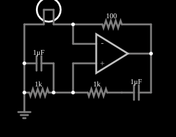

# Oscilador em ponte de Wien

<!-- navegacao:inicio -->
[Índice](README.md) · [Anterior: Light Bulb](lightbulb.md)
<!-- navegacao:fim -->

## Objetivo

Mostrar o **oscilador em ponte de Wien**, em que uma lâmpada incandescente estabiliza a amplitude: quando a oscilação cresce, a lâmpada esquenta, sua resistência sobe e o ganho cai, o que mantém a amplitude constante.

## O circuito

<!-- esquema:inicio -->

<!-- esquema:fim -->

Um amp-op ($\text{Av} = 10^5$, saturação em $\pm 15\ \text{V}$) tem uma rede RC de Wien na entrada não inversora: um circuito série ($1\ \text{k}\Omega$ e $1\ \mu\text{F}$) e um paralelo ($1\ \text{k}\Omega$ e $1\ \mu\text{F}$). A realimentação negativa é um divisor com um resistor de $100\ \Omega$ e uma lâmpada ($0{,}5\ \text{W}$, $6\ \text{V}$, constantes de tempo de $40\ \text{ms}$).

<!-- componentes:inicio -->
| N.º | Tipo | Elemento | Valores |
|----:|------|----------|---------|
| 0 | `LampElm` | lamp | Nominal Power = 500m; Nominal Voltage = 6; Warmup Time (s) = 40m; Cooldown Time (s) = 40m |
| 1 | `ResistorElm` | resistor | Resistance (ohms) = 100 |
| 2 | `OpAmpElm` | op-amp | Max Output (V) = 15; Min Output (V) = -15; Gain = 100k |
| 5 | `CapacitorElm` | capacitor | Capacitance (F) = 1μ; Trapezoidal Approximation = sim; Initial Voltage (on Reset) = 1m; Series Resistance = 0 |
| 6 | `ResistorElm` | resistor | Resistance (ohms) = 1k |
| 12 | `GroundElm` | ground | Symbol = Earth |
| 13 | `ResistorElm` | resistor | Resistance (ohms) = 1k |
| 14 | `CapacitorElm` | capacitor | Capacitance (F) = 1μ; Trapezoidal Approximation = sim; Initial Voltage (on Reset) = 1m; Series Resistance = 0 |
<!-- componentes:fim -->

## Teoria

A rede de Wien tem, na frequência $f_0 = 1/(2\pi RC)$, defasagem nula e atenuação $1/3$. A oscilação precisa de ganho de malha $1$, isto é, ganho do amplificador igual a $3$:

$$f_0 = \frac{1}{2\pi RC} = \frac{1}{2\pi\cdot 1\ \text{k}\Omega\cdot 1\ \mu\text{F}} = 159{,}2\ \text{Hz},\qquad A_v = 1 + \frac{R_f}{R_{lamp}} = 3\ \Rightarrow\ R_{lamp} = \frac{R_f}{2} = 50\ \Omega.$$

Se o ganho for maior que $3$, a oscilação cresce; a lâmpada, com resistência que sobe com a potência dissipada, diminui o ganho e leva a amplitude ao ponto em que $R_{lamp} = 50\ \Omega$. É um controle automático de ganho analógico.

## Resultados esperados

O simulador dá, em regime permanente:

- **Frequência:** $159{,}5\ \text{Hz}$ (teoria: $159{,}2\ \text{Hz}$).
- **Amplitude da saída:** $\pm 11{,}54\ \text{V}$, senoidal e estável.
- **Lâmpada:** valor eficaz de $2{,}714\ \text{V}$ e $54{,}3\ \text{mA}$, isto é, $R = 2{,}714/0{,}05429 = 50{,}0\ \Omega$ (o valor previsto) e $P = 0{,}147\ \text{W}$.
- **Partida:** a amplitude começa saturada em $\pm 15\ \text{V}$ e cai para $11{,}54\ \text{V}$ em menos de $0{,}5\ \text{s}$ (em $0{,}2\ \text{s}$ está em $11{,}89\ \text{V}$).

## O que observar

Veja no osciloscópio a amplitude começar alta e se acomodar: é a lâmpada esquentando. Depois de estabilizada, a senoide tem pouca distorção, bem melhor que a de um oscilador com limitação por diodos.

## Limites do modelo

- O modelo da lâmpada tem inércia térmica de $40\ \text{ms}$, pouca em relação ao período, por isso a resistência acompanha parte do ciclo e há alguma distorção.
- O amp-op é ideal, sem produto ganho–banda finito.

## Referências

Incropera e DeWitt, *Fundamentals of Heat and Mass Transfer* (resistividade do tungstênio); Horowitz e Hill, *The Art of Electronics*, seção sobre lâmpadas incandescentes.

O circuito deste exemplo faz parte da coleção do simulador original de Paul Falstad e Iain Sharp (CircuitJS1); a explicação é deste projeto.
