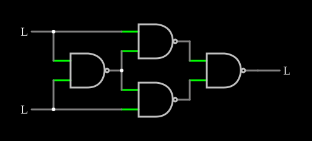

# OU-exclusivo com quatro NANDs

<!-- navegacao:inicio -->
[Índice](README.md) · [Próximo: Half Adder](halfadd.md)
<!-- navegacao:fim -->

## Objetivo

Mostrar como se monta a porta **OU-exclusivo (XOR)** com quatro portas NAND de duas entradas, a construção clássica que prova, na prática, que a NAND é uma porta *universal*.

## O circuito

<!-- esquema:inicio -->

<!-- esquema:fim -->

Duas entradas lógicas, $A$ (elemento 13) e $B$ (elemento 14), e quatro portas NAND ideais de duas entradas (sem atraso, nível alto de $5\ \text{V}$). A primeira NAND recebe $A$ e $B$; a sua saída vai a uma entrada de cada uma de duas NANDs intermediárias, cuja outra entrada é $A$ numa e $B$ na outra; a quarta NAND junta as duas intermediárias e aciona a saída lógica (elemento 12). O exemplo abre com as duas entradas em $0$.

<!-- componentes:inicio -->
| N.º | Tipo | Elemento | Valores |
|----:|------|----------|---------|
| 0 | `NandGateElm` | NAND gate | # of Inputs = 2; High Logic Voltage = 5; Schmitt Inputs = não; Invert Inputs = não; Propagation Delay (s) = 0; DeMorgan's Symbol = não |
| 1 | `NandGateElm` | NAND gate | # of Inputs = 2; High Logic Voltage = 5; Schmitt Inputs = não; Invert Inputs = não; Propagation Delay (s) = 0; DeMorgan's Symbol = não |
| 2 | `NandGateElm` | NAND gate | # of Inputs = 2; High Logic Voltage = 5; Schmitt Inputs = não; Invert Inputs = não; Propagation Delay (s) = 0; DeMorgan's Symbol = não |
| 5 | `NandGateElm` | NAND gate | # of Inputs = 2; High Logic Voltage = 5; Schmitt Inputs = não; Invert Inputs = não; Propagation Delay (s) = 0; DeMorgan's Symbol = não |
| 12 | `LogicOutputElm` | logic output | Threshold = 2.5; Current Required = não; Numeric = não; Ternary = não |
| 13 | `LogicInputElm` | logic input | Momentary Switch = não; High Logic Voltage = 5; Low Voltage = 0; Numeric = não; Ternary = não; Keyboard Shortcut =  |
| 14 | `LogicInputElm` | logic input | Momentary Switch = não; High Logic Voltage = 5; Low Voltage = 0; Numeric = não; Ternary = não; Keyboard Shortcut =  |
<!-- componentes:fim -->

## Teoria

Seja $N = \overline{AB}$ a saída da primeira NAND. As intermediárias dão $\overline{A N}$ e $\overline{B N}$, e a última

$$Y = \overline{\overline{AN} \cdot \overline{BN}} = AN + BN = (A + B)\,\overline{AB} = A\,\overline{B} + \overline{A}\,B = A \oplus B.$$

A saída é $1$ quando as entradas são **diferentes**. A XOR é também a soma de dois bits sem o vai-um, e por isso aparece em todos os somadores ([Half Adder](halfadd.md), [Full Adder](fulladd.md)), além de comparadores e geradores de paridade.

## Resultados esperados

O simulador dá:

| $A$ | $B$ | $Y$ |
|----:|----:|----:|
| 0 | 0 | 0 |
| 1 | 0 | 1 ($5\ \text{V}$) |
| 0 | 1 | 1 ($5\ \text{V}$) |
| 1 | 1 | 0 |

## O que observar

Clique nas entradas e acompanhe os níveis nas saídas das quatro NANDs. Uma XOR em transistores, com bem menos componentes, está em [CMOS XOR](cmosxor.md).

## Limites do modelo

- As portas são ideais e sem atraso; numa XOR real de quatro NANDs, a saída passa por três níveis de porta e pode ter um *glitch* quando as duas entradas mudam juntas.

## Referências

Mano e Ciletti, *Digital Design*, capítulo sobre álgebra booleana e portas universais; Wakerly, *Digital Design: Principles and Practices*, capítulo sobre lógica combinacional.

O circuito deste exemplo faz parte da coleção do simulador original de Paul Falstad e Iain Sharp (CircuitJS1); a explicação é deste projeto.
