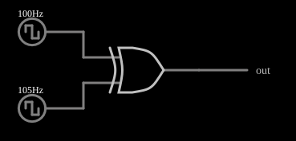

# Detector de fase com porta XOR

<!-- navegacao:inicio -->
[Índice](README.md) · [Próximo: Type I PLL](pll.md)
<!-- navegacao:fim -->

## Objetivo

Mostrar que uma porta XOR é um detector de fase: com duas ondas quadradas de mesma frequência, o valor médio da saída é proporcional à diferença de fase entre elas. O exemplo usa duas frequências ligeiramente diferentes ($100$ e $105\ \text{Hz}$), e a defasagem varre todos os valores em cada ciclo de batimento.

## O circuito

<!-- esquema:inicio -->

<!-- esquema:fim -->

Duas fontes de onda quadrada de $0$ a $5\ \text{V}$ e ciclo de trabalho de $50\%$ ($100\ \text{Hz}$ e $105\ \text{Hz}$) alimentam as duas entradas de uma porta XOR de $5\ \text{V}$. Um elemento de saída e três osciloscópios mostram as entradas e a saída.

<!-- componentes:inicio -->
| N.º | Tipo | Elemento | Valores |
|----:|------|----------|---------|
| 0 | `RailElm` | square wave gen | Max Voltage = 2.5; Waveform = Square Wave; DC Offset (V) = 2.5; Internal Resistance (ohms) = 0; Show Voltage = não; Specify As = Frequency/Duty Cycle; Frequency (Hz) = 100; Phase Offset (degrees) = 0; Duty Cycle = 50; Rise/Fall Time (s) = 0 |
| 1 | `RailElm` | square wave gen | Max Voltage = 2.5; Waveform = Square Wave; DC Offset (V) = 2.5; Internal Resistance (ohms) = 0; Show Voltage = não; Specify As = Frequency/Duty Cycle; Frequency (Hz) = 105; Phase Offset (degrees) = 0; Duty Cycle = 50; Rise/Fall Time (s) = 0 |
| 2 | `XorGateElm` | XOR gate | # of Inputs = 2; High Logic Voltage = 5; Schmitt Inputs = não; Propagation Delay (s) = 0; DeMorgan's Symbol = não |
| 3 | `OutputElm` | output | Show Voltage = não |
<!-- componentes:fim -->

## Teoria

A saída de uma XOR é alta quando as duas entradas diferem. Para duas quadradas de ciclo de trabalho de $50\%$ e defasagem $\varphi$ (de $0$ a $\pi$), a saída é alta durante a fração $\varphi/\pi$ do período, e o valor médio é

$$\overline{v_\text{out}} = V_{DD}\,\frac{|\varphi|}{\pi}, \qquad |\varphi| \le \pi.$$

A característica é uma triangular em $\varphi$, com mínimo ($0$) em fase, máximo ($V_{DD}$) em oposição de fase e valor médio $V_{DD}/2$ em quadratura ($\varphi = 90^\circ$). Num PLL o detector de fase é seguido de um filtro passa-baixas que extrai esse valor médio.

Com frequências diferentes, a defasagem cresce linearmente no tempo, $\varphi(t) = 2\pi\,(f_2 - f_1)\,t = 2\pi\cdot 5\ \text{Hz}\cdot t$, e a saída é um sinal de $5\ \text{Hz}$ ao ser filtrado: o **batimento**.

## Resultados esperados

Em uma janela de $0{,}2\ \text{s}$ (um ciclo completo de batimento de $5\ \text{Hz}$) a defasagem varre $0$ a $2\pi$ e:

| Grandeza | Teoria | Simulador |
|----------|-------:|----------:|
| Valor médio em um ciclo de batimento | $V_{DD}/2 = 2{,}5\ \text{V}$ | $2{,}498\ \text{V}$ |
| Níveis da saída | $0$ e $5\ \text{V}$ | $0$ e $5\ \text{V}$ |

As verificações conferem o valor médio e os níveis. Num detector real, um filtro $RC$ com frequência de corte bem abaixo de $100\ \text{Hz}$ mostraria a saída como uma triangular de $5\ \text{Hz}$ entre $0$ e $5\ \text{V}$.

## O que observar

- Quando as duas ondas estão em fase, a saída fica em nível baixo; em oposição de fase, em nível alto; entre uma e outra, ela é uma sequência de pulsos cuja largura cresce e decresce no ritmo de $5\ \text{Hz}$.
- O detector XOR só mede fases de $0$ a $\pi$ e exige ciclo de trabalho de $50\%$ nas duas entradas.
- Veja como o ciclo de trabalho médio muda lentamente: é o princípio do detector de fase do PLL tipo I (exemplo "Type I PLL").

## Limites do modelo

A porta XOR é ideal, sem atraso de propagação, e as ondas quadradas têm bordas instantâneas. O valor médio de $2{,}5\ \text{V}$ vale para um ciclo inteiro de batimento: em uma janela mais curta o valor médio é o da defasagem naquele trecho.

## Referências

- R. E. Best, *Phase-Locked Loops: Design, Simulation, and Applications*, McGraw-Hill.
- F. M. Gardner, *Phaselock Techniques*, Wiley.
- B. Razavi, *Design of Analog CMOS Integrated Circuits*, McGraw-Hill.

O circuito deste exemplo faz parte da coleção do simulador original de Paul Falstad e Iain Sharp (CircuitJS1); a explicação é deste projeto.
