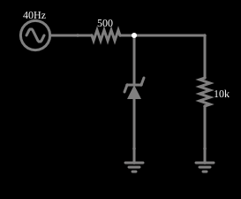

# Referência de tensão com Zener

<!-- navegacao:inicio -->
[Índice](README.md) · [Anterior: I/V Curve](zeneriv.md) · [Próximo: Voltage Reference w/ Follower](zenerreffollow.md)
<!-- navegacao:fim -->

## Objetivo

Mostrar o diodo Zener como regulador: a tensão de saída varia muito menos que a tensão de entrada, porque o Zener absorve as variações da corrente.

## O circuito

<!-- esquema:inicio -->

<!-- esquema:fim -->

Uma fonte de $6{,}7\ \text{V}$ com uma oscilação de $\pm 1\ \text{V}$ ($40\ \text{Hz}$) alimenta, através de um resistor de $500\ \Omega$, um Zener de $5{,}6\ \text{V}$ em paralelo com uma carga de $10\ \text{k}\Omega$. Três osciloscópios mostram a entrada, a saída e a tensão do Zener.

<!-- componentes:inicio -->
| N.º | Tipo | Elemento | Valores |
|----:|------|----------|---------|
| 0 | `RailElm` | A/C source | Max Voltage = 1; Waveform = A/C; DC Offset (V) = 6.7; Internal Resistance (ohms) = 0; Show Voltage = não; Frequency (Hz) = 40; Phase Offset (degrees) = 0 |
| 1 | `ZenerElm` | Zener diode | Model = default-zener |
| 2 | `GroundElm` | ground | Symbol = Earth |
| 4 | `ResistorElm` | resistor | Resistance (ohms) = 10k |
| 5 | `GroundElm` | ground | Symbol = Earth |
| 6 | `ResistorElm` | resistor | Resistance (ohms) = 500 |
<!-- componentes:fim -->

## Teoria

O Zener, em ruptura, comporta-se como uma fonte de tensão de resistência pequena $r_Z$. O circuito é então um divisor entre $R_s = 500\ \Omega$ e $r_Z\,\|\,R_L$, e uma variação $\Delta V_{in}$ na entrada produz na saída

$$\Delta V_{out} \approx \Delta V_{in}\,\frac{r_Z}{R_s + r_Z},$$

muito menor, porque $r_Z \ll R_s$. Em baixa corrente, porém, $r_Z = V_T/i$ é grande (a $0{,}5\ \text{mA}$, $52\ \Omega$) e a regulação é pior. A tensão de saída é a que satisfaz a equação de corrente do nó:

$$\frac{V_{in} - V}{R_s} = \frac{V}{R_L} + |i_Z(V)|,$$

em que $i_Z$ é a curva do exemplo anterior.

## Resultados esperados

A solução do ponto de operação, com a curva do Zener (cálculo independente do circuito), dá uma tensão de saída que varia entre $5{,}426\ \text{V}$ (entrada em $5{,}7\ \text{V}$) e $5{,}592\ \text{V}$ (entrada em $7{,}7\ \text{V}$): a variação de $2\ \text{V}$ na entrada vira $0{,}166\ \text{V}$ na saída, uma **redução de 12 vezes**. A corrente média do Zener é $1{,}74\ \text{mA}$. A tensão de saída é um pouco menor que os $5{,}6\ \text{V}$ nominais, porque a corrente é menor que os $5\ \text{mA}$ da definição do Zener. As verificações conferem os dois extremos da tensão do Zener e da carga (tolerância de 1%).

## O que observar

- A saída (osciloscópio central) varia muito menos que a entrada.
- Reduza o resistor de $500\ \Omega$: a corrente do Zener sobe e a regulação melhora ($r_Z$ menor), à custa de mais potência dissipada.
- Aumente a carga ($R_L$ menor, mais corrente): a saída cai, porque o Zener fornece menos corrente.

## Limites do modelo

O Zener do modelo tem tensão de ruptura de $5{,}6\ \text{V}$ definida pela corrente de $5\ \text{mA}$; reguladores reais têm tolerância (de 5%) e coeficiente de temperatura. O circuito não tem capacitor de filtro. A regulação é ruim para correntes abaixo de $1\ \text{mA}$.

## Referências

- A. S. Sedra e K. C. Smith, *Microeletrônica*, Pearson.
- P. Horowitz e W. Hill, *The Art of Electronics*, Cambridge University Press.

O circuito deste exemplo faz parte da coleção do simulador original de Paul Falstad e Iain Sharp (CircuitJS1); a explicação é deste projeto.
