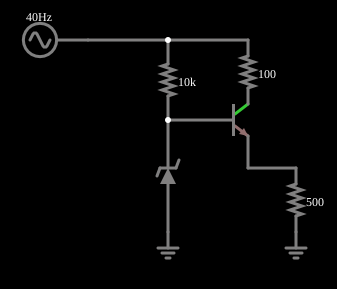

# Referência de tensão com seguidor

<!-- navegacao:inicio -->
[Índice](README.md) · [Anterior: Voltage Reference](zenerref.md)
<!-- navegacao:fim -->

## Objetivo

Mostrar como um transistor seguidor de emissor melhora a referência com Zener: o Zener fica com pouca corrente (a regulação da referência é melhor) e a carga é alimentada pelo transistor.

## O circuito

<!-- esquema:inicio -->

<!-- esquema:fim -->

Uma fonte de $8{,}8\ \text{V}$ com oscilação de $\pm 2\ \text{V}$ ($40\ \text{Hz}$) alimenta, por um resistor de $10\ \text{k}\Omega$, a base de um transistor NPN com um Zener de $5{,}6\ \text{V}$ para a terra; o coletor liga-se à fonte por um resistor de $100\ \Omega$ e o emissor alimenta uma carga de $500\ \Omega$.

<!-- componentes:inicio -->
| N.º | Tipo | Elemento | Valores |
|----:|------|----------|---------|
| 0 | `RailElm` | A/C source | Max Voltage = 2; Waveform = A/C; DC Offset (V) = 8.8; Internal Resistance (ohms) = 0; Show Voltage = não; Frequency (Hz) = 40; Phase Offset (degrees) = 0 |
| 2 | `ResistorElm` | resistor | Resistance (ohms) = 10k |
| 3 | `NTransistorElm` | transistor | Beta/hFE = 100; Swap E/C = não; Draw Circle = não; Model = default |
| 4 | `ResistorElm` | resistor | Resistance (ohms) = 100 |
| 6 | `ZenerElm` | Zener diode | Model = default-zener |
| 9 | `ResistorElm` | resistor | Resistance (ohms) = 500 |
| 10 | `GroundElm` | ground | Symbol = Earth |
| 11 | `GroundElm` | ground | Symbol = Earth |
<!-- componentes:fim -->

## Teoria

O Zener fixa a tensão da base em $V_Z$, e o emissor segue a base menos a queda base-emissor:

$$V_{saida} = V_Z - V_{BE},\qquad V_{BE} = V_T\ln\frac{I_E}{I_s}\ \ (I_s = 10^{-13}\ \text{A}\text{ no modelo padrão}).$$

A corrente da carga ($\approx 9{,}7\ \text{mA}$) é fornecida pelo transistor; o Zener só precisa da corrente de base e da que passa pelo resistor de $10\ \text{k}\Omega$. A resistência de saída é $r_{sai} \approx r_Z\,\|\,(R_b/\beta)$, pequena, de modo que a saída é uma referência "forte".

## Resultados esperados

Com a base em $\approx 5{,}5\ \text{V}$ e $I_E = 9{,}7\ \text{mA}$, $V_{BE} = 0{,}0259\ln(9{,}7\ \text{mA}/10^{-13}) = 0{,}654\ \text{V}$ e $V_{saida} \approx 5{,}5 - 0{,}65 = 4{,}85\ \text{V}$. O simulador dá uma saída entre $4{,}819$ e $4{,}882\ \text{V}$ (variação de $63\ \text{mV}$ para $4\ \text{V}$ de variação na entrada, uma redução de 63 vezes, contra 12 vezes do exemplo anterior), e a tensão do Zener entre $5{,}473$ e $5{,}537\ \text{V}$. A corrente média do Zener é de só $0{,}23\ \text{mA}$. As verificações conferem os extremos da saída e do Zener (tolerância de 1%; são valores do simulador: o integrador independente usado neste conjunto de exemplos não inclui transistores, e a estimativa acima só confere a ordem de grandeza).

## O que observar

- A saída ($4{,}85\ \text{V}$) é uma queda $V_{BE}$ abaixo da tensão do Zener.
- Compare a redução da ondulação com a do exemplo anterior ($63$ contra $12$ vezes): o seguidor torna a referência cerca de 5 vezes mais imune à entrada, e com uma carga maior.
- O transistor fornece a corrente da carga: o Zener não precisa fazê-lo.

## Limites do modelo

Modelo de transistor padrão (ganho $\beta = 100$); a tensão da saída depende da temperatura por $V_{BE}$ (cerca de $-2\ \text{mV}/^\circ\text{C}$), e o Zener é ideal. A tolerância do Zener real ($\pm 5\%$) desloca toda a referência.

## Referências

- A. S. Sedra e K. C. Smith, *Microeletrônica*, Pearson.
- P. Horowitz e W. Hill, *The Art of Electronics*, Cambridge University Press.

O circuito deste exemplo faz parte da coleção do simulador original de Paul Falstad e Iain Sharp (CircuitJS1); a explicação é deste projeto.
